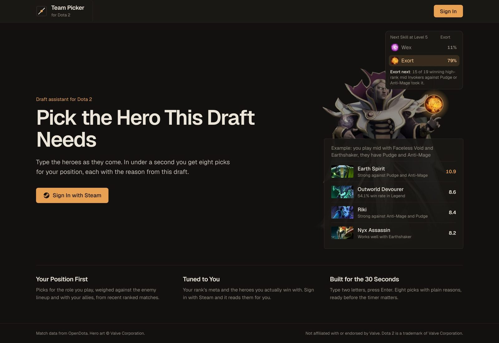
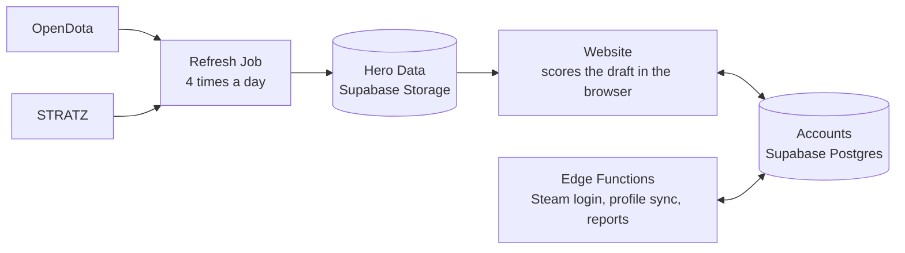

<div align="center">


# Dota 2 Team Picker: Backend

**The data and the scoring engine behind the draft assistant.**<br>
Your team's picks, the enemy picks and your position go in.<br>
Eight heroes come out, each with a short reason from this draft.

[](https://dota2-team-picker-web.vercel.app)
[](https://github.com/MCantuncer/dota2-team-picker/actions/workflows/ci.yml)
[](https://github.com/MCantuncer/dota2-team-picker/actions/workflows/database.yml)
[](https://github.com/MCantuncer/dota2-team-picker/actions/workflows/refresh-data.yml)
[](https://github.com/MCantuncer/dota2-team-picker/actions/workflows/codeql.yml)

[](https://www.typescriptlang.org)
[](https://nodejs.org)
[](https://supabase.com)
[](https://deno.com)
[](https://vitest.dev)
[](https://www.opendota.com)

<a href="https://dota2-team-picker-web.vercel.app"></a>

The website lives in [dota2-team-picker-web](https://github.com/MCantuncer/dota2-team-picker-web).

</div>

## How It Fits Together



## Services

Each service is its own folder under `services/`, set up as an npm workspace.

| Service | What It Does |
| --- | --- |
| [`services/engine`](services/engine) | Downloads hero data and scores picks: counters, synergy, meta at your rank, position fit and your comfort. Try it from the command line. |
| [`services/accounts`](services/accounts) | Accounts on Supabase: profiles, hero pools, friends, parties and Stacks, Steam sign-in and rank sync. |

## Quick Start

```sh
npm install     # installs every service
npm test        # tests every service
npm run suggest -w services/engine -- --pos 2 --allies "Lion:5,Juggernaut:1" --enemies "Pudge,Axe" --rank 6
```

<details>
<summary><strong>All Commands and CI</strong></summary>

```sh
npm run typecheck
npm run lint            # Deno lint + format check for the edge functions
npm run test:coverage
```

CI runs on every pull request and on `main`:

- **Engine**: type check, Vitest with a coverage floor (the run fails if coverage drops below it).
- **Accounts**: Deno lint, format check, type check and tests for the edge functions and email builder.
- **Database**: migrations, lint and row level security tests on a local Supabase stack.
- **Engine backtest**: scores the PR's engine and main's on the same saved games (report only).
- **Dependency review**: fails a pull request that adds a package with a known high or critical vulnerability.
- **CodeQL**: security scan of the TypeScript code and the workflows, also weekly.

Dependabot opens grouped update PRs for npm packages and GitHub Actions every week.

</details>

## Contributing

Read [CONTRIBUTING.md](CONTRIBUTING.md) before opening a pull request: it holds the code standards and the checklist
every change follows.

<sub>Match data from OpenDota and STRATZ. Hero art © Valve Corporation. Not affiliated with or endorsed by Valve.
Dota 2 is a trademark of Valve Corporation.</sub>
